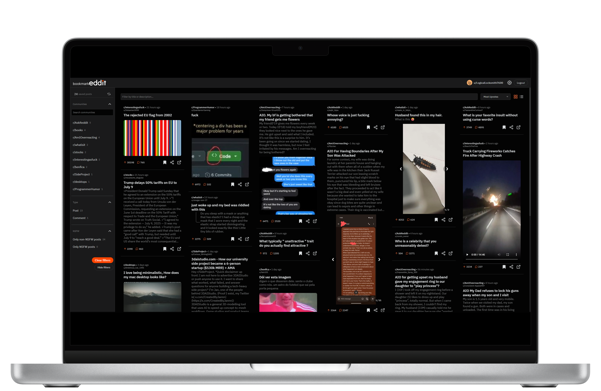
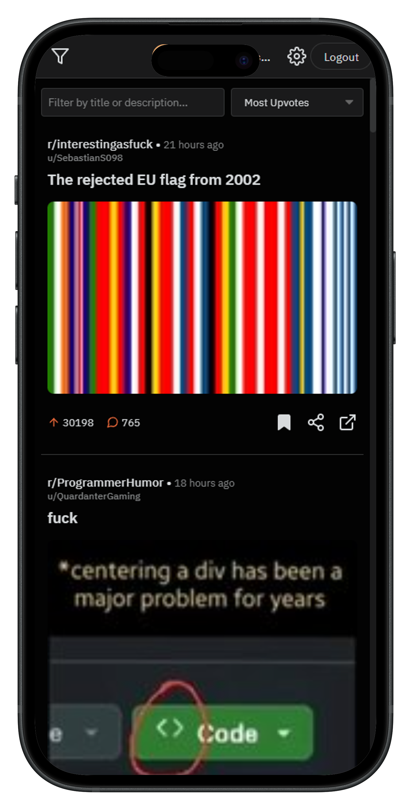

# Bookmarkeddit

<div align="center">
  
  <p><strong>Reddit's missing save manager: Finally organize what matters to you</strong></p>
  <p>A modern tool to organize, search, and manage your Reddit saved posts and comments.</p>
  <p>
    <a href="https://bookmarkeddit.com" target="_blank"><strong>Live Demo</strong></a> |
    <a href="#features">Features</a> |
    <a href="#getting-started">Getting Started</a> |
    <a href="#docker-swarm-deployment-with-caddy">Deployment</a>
  </p>
</div>

## Overview

Reddit's native saved posts feature is pretty basic. You save something, it goes into a list, and that's about it. If you're like me and have hundreds (or thousands) of saved posts, finding anything becomes a real pain.

Bookmarkeddit fixes that. It's built with React and TypeScript, connects to Reddit's API, and everything runs in your browser. Your data stays on your machine.

## Preview


_Desktop View_


_Mobile View_

[**Desktop Demo**](https://imgur.com/a/5c7KBQm) | [**Mobile Demo**](https://imgur.com/a/GQWOYfW)

## Features

- **Search**: Full-text search across titles and post content
- **Filters**: Filter by subreddit, post type (text/image/video), or NSFW status
- **Multiple layouts**: Switch between grid and list views
- **Sorting**: Sort by date, upvotes, or comment count
- **Automatic fetching**: Grabs all your saved posts, working around Reddit's API pagination
- **Light/Dark mode**: Because your eyes matter
- **Privacy-focused**: Everything runs in your browser, no data stored on servers

### What else it does

- Works on desktop and mobile
- Keyboard shortcuts (`Ctrl+F` for search, `Ctrl+R` to refresh)
- Fuzzy search for when you can't remember the exact words
- Masonry grid layout that actually looks decent
- Inline image and video viewing
- NSFW content blurring with click-to-reveal
- Infinite scroll for large collections
- Unsave posts directly from the app

## 🚀 Getting Started

### Prerequisites

- Node.js (v16 or higher recommended)
- A Reddit account
- Reddit Developer Application credentials (see below)

### Reddit API Credentials Setup

1. Go to [Reddit's App Preferences](https://www.reddit.com/prefs/apps).
2. Click "Create App" or "Create Another App".
3. Fill in the details:
   - **Name**: Bookmarkeddit (or your preferred name)
   - **App type**: Select "web app"
   - **Description**: (Optional)
   - **About URL**: (Optional)
   - **Redirect URI**:
     - For local development: `http://localhost:5173/login/callback`

## Getting Startedmatches your `VITE_REDIRECT_URI` in the respective `.env` file)\_

4. Click "Create app".
5. Note your **Client ID** (under the app name) and **Client Secret**.

### Installation & Local Development

1. Clone the repository:

   ```bash
   git clone https://github.com/mateussilva98/bookmarkeddit.git
   # Replace with your fork if applicable
   cd bookmarkeddit
   ```

2. Install dependencies for both the client app and the server:

   ```bash
   # Install client app dependencies
   cd app
   npm install

   # Install server dependencies
   cd ../server
   npm install
   cd ..
   # Return to root for next steps
   ```

3. Create and configure environment files:

   **For the server (`server/.env`):**

   Copy `server/example.env` to `server/.env` and fill in:

   ```env
   NODE_ENV=development
   PORT=3000 # Or your preferred port for the proxy server
   REDDIT_CLIENT_ID=YOUR_REDDIT_CLIENT_ID
   REDDIT_CLIENT_SECRET=YOUR_REDDIT_CLIENT_SECRET
   ```

   **For the client app (`app/.env):**

   Copy `app/example.env` to `app/.env` and fill in:

   ```env
   VITE_API_URL=http://localhost:3000/api # Points to the proxy server
   VITE_CLIENT_ID=YOUR_REDDIT_CLIENT_ID
   VITE_REDIRECT_URI=http://localhost:5173/login/callback
   ```

   _(Note: `VITE_CLIENT_ID` in the app is the same as `REDDIT_CLIENT_ID` for the server)_

4. Start the development servers:

   ```bash
   # Start the proxy server
   cd server
   npm run dev

   # In another terminal, start the frontend
   cd ../app
   # or cd app from the root directory if you opened a new terminal
   npm run dev
   ```

5. Open your browser and navigate to `http://localhost:5173`.

## Authentication & Permissions

When you log in, Bookmarkeddit requests these Reddit API permissions:

- `identity`: Shows your username and profile picture
- `history`: Accesses your saved posts and comments
- `save`: Lets you unsave posts from the app

## Privacy

Your Reddit data gets fetched by the client and stored in your browser's local storage. The backend server just proxies requests to Reddit's API—it doesn't store anything about you or your saved posts.

## Tech Stack

- **Frontend**: React, TypeScript, SCSS Modules, Vite
- **Backend**: Node.js, Express, TypeScript (just a proxy server)
- **API**: Reddit API
- **State Management**: Zustand
- **Deployment**: Docker, Docker Swarm, Caddy
- **Analytics**: Self-hosted Plausible

## Planned Features

- Export to CSV/JSON
- Better markdown rendering for post content
- Stats dashboard
- Pin posts to the top
- Better caching

## Contributing

Found a bug or have an idea? Open an issue or submit a PR.

## 📝 License

This project is licensed under the MIT License - see the [LICENSE](./LICENSE) file for details.

## License

MIT License - see [LICENSE](./LICENSE) for details.

Created by [Mateus Silva](https://github.com/mateussilva98/)

<p align="center">
  <i>Your data, better organized. Never lose a valuable Reddit post again.</i>
</p>
